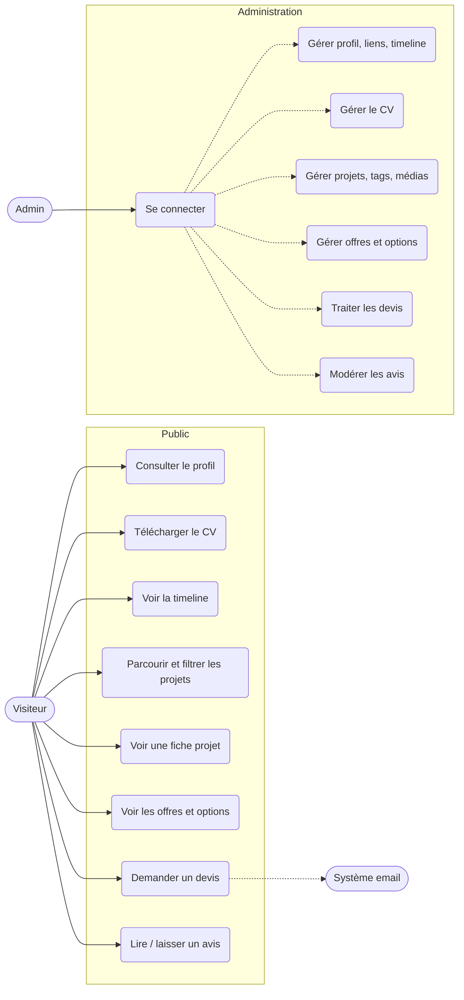
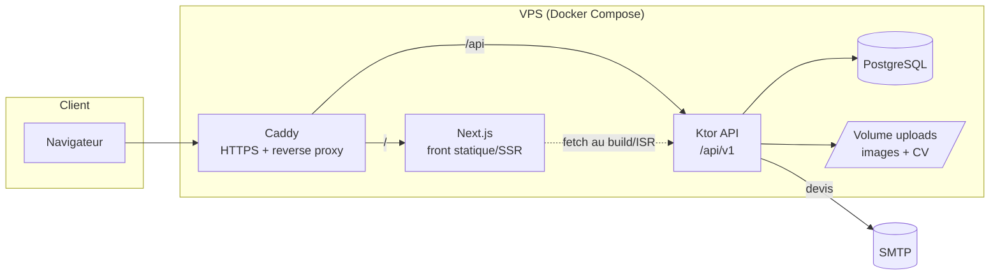
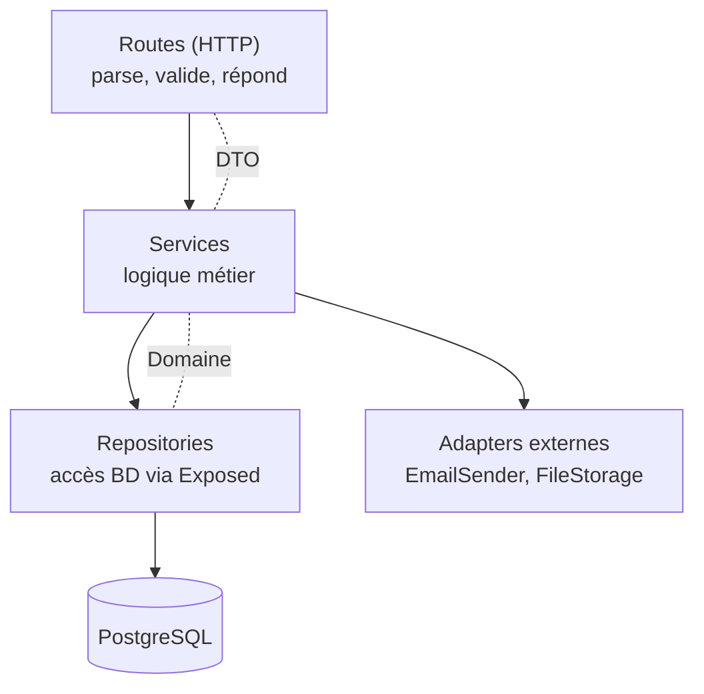
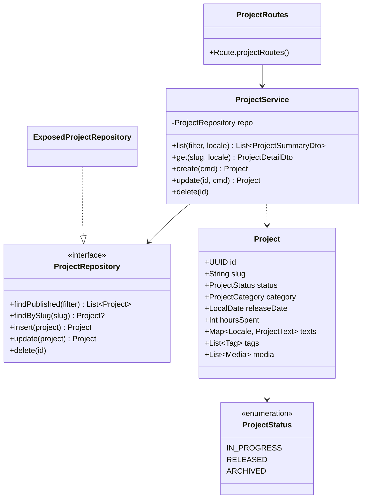
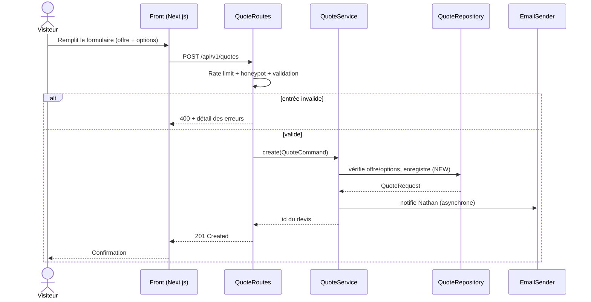
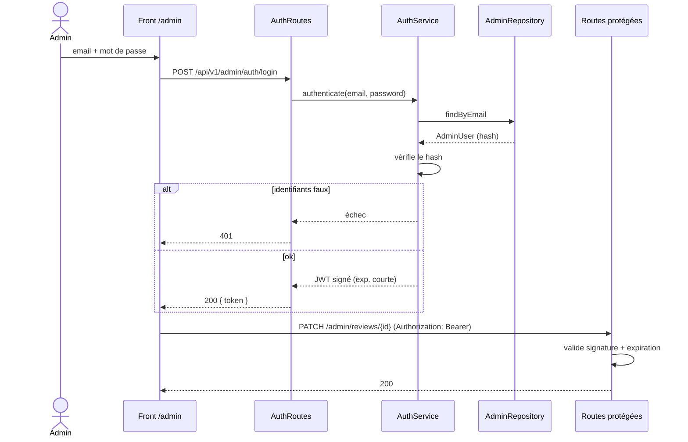
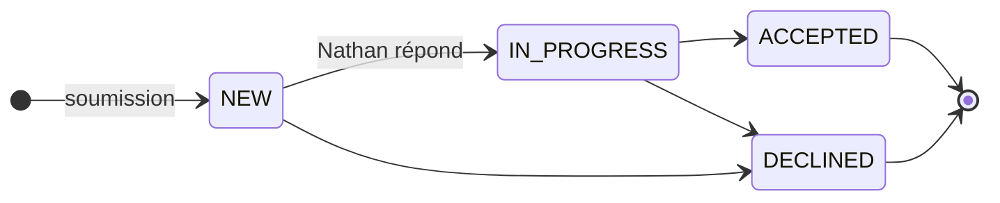
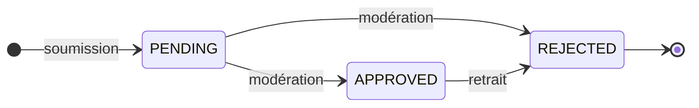
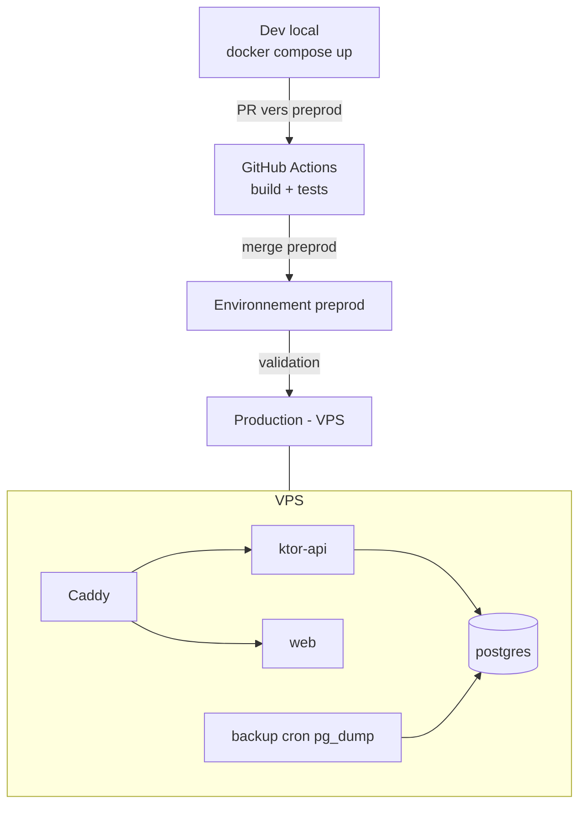

# 02 — Architecture et UML

> Les diagrammes sont en **Mermaid** : ils s'affichent directement dans GitHub et dans l'aperçu Markdown d'IntelliJ.

## 1. Cas d'usage



## 2. Architecture globale



## 3. Architecture interne du backend (en couches)



Règles :
- une route **ne parle jamais** à la base directement ;
- les **DTO** (ce que voit l'API) sont séparés du **modèle de domaine** (ce que manipule le métier) ;
- les dépendances sont injectées par **Koin** (donc faciles à remplacer en test).

### Structure du dépôt

```
Portfollio/
├── backend/                 # Kotlin / Ktor (Nathan)
│   ├── build.gradle.kts
│   └── src/
│       ├── main/kotlin/dev/nathan/portfolio/
│       │   ├── Application.kt
│       │   ├── config/          # env, Koin, plugins Ktor
│       │   ├── routes/          # public/ et admin/
│       │   ├── service/
│       │   ├── repository/
│       │   ├── domain/          # entités + enums
│       │   ├── dto/
│       │   ├── security/        # JWT, hash
│       │   └── infra/           # email, stockage fichiers
│       ├── main/resources/db/migration/   # V1__init.sql ...
│       └── test/kotlin/
├── web/                     # Next.js (Claude)
├── infra/                   # docker-compose, Caddyfile, scripts backup
├── docs/
└── .github/workflows/
```

## 4. Modèle de données (ER)

Stratégie i18n : les textes éditoriaux vivent dans des **tables de traduction** (`*_translation`) avec une colonne `locale` (`fr` / `en`).

```mermaid
erDiagram
    ADMIN_USER {
        uuid id PK
        string email UK
        string password_hash
        timestamp created_at
    }

    PROFILE {
        int id PK "singleton"
        string display_name
        string avatar_path
        string availability "AVAILABLE | BUSY | UNAVAILABLE"
    }
    PROFILE_TRANSLATION {
        int profile_id FK
        string locale
        string tagline
        text bio
    }
    SOCIAL_LINK {
        uuid id PK
        string label
        string url
        int position
    }

    TIMELINE_ENTRY {
        uuid id PK
        string type "EDUCATION | EXPERIENCE | MILESTONE"
        date start_date
        date end_date "nullable"
        int position
    }
    TIMELINE_TRANSLATION {
        uuid entry_id FK
        string locale
        string title
        text description
    }

    CV_DOCUMENT {
        uuid id PK
        string locale
        string file_path
        boolean is_current
        int download_count
        timestamp uploaded_at
    }

    PROJECT {
        uuid id PK
        string slug UK
        string status "IN_PROGRESS | RELEASED | ARCHIVED"
        string category "WEB | MOBILE | BACKEND | OTHER"
        date release_date
        int hours_spent
        string demo_url
        string repo_url
        string trailer_url
        boolean published
        timestamp created_at
    }
    PROJECT_TRANSLATION {
        uuid project_id FK
        string locale
        string title
        string summary
        text description
    }
    TAG {
        uuid id PK
        string name UK
        string kind "TECH | TOPIC"
    }
    PROJECT_TAG {
        uuid project_id FK
        uuid tag_id FK
    }
    MEDIA {
        uuid id PK
        uuid project_id FK
        string type "IMAGE | VIDEO"
        string path_or_url
        string caption
        int position
        boolean is_cover
    }

    OFFER {
        uuid id PK
        string slug UK
        int base_price_cents
        string currency
        int delivery_days
        boolean published
    }
    OFFER_TRANSLATION {
        uuid offer_id FK
        string locale
        string title
        string summary
        text description
    }
    OFFER_OPTION {
        uuid id PK
        uuid offer_id FK
        int price_cents
        int position
    }
    OFFER_OPTION_TRANSLATION {
        uuid option_id FK
        string locale
        string title
        string description
    }

    QUOTE_REQUEST {
        uuid id PK
        string name
        string email
        text message
        uuid offer_id FK "nullable"
        string status "NEW | IN_PROGRESS | ACCEPTED | DECLINED"
        string locale
        timestamp created_at
    }
    QUOTE_REQUEST_OPTION {
        uuid quote_id FK
        uuid option_id FK
    }

    REVIEW {
        uuid id PK
        string author_name
        string author_email "privé, jamais exposé"
        int rating "1 à 5"
        text comment
        uuid project_id FK "nullable"
        uuid offer_id FK "nullable"
        string status "PENDING | APPROVED | REJECTED"
        timestamp created_at
    }

    PROFILE ||--o{ PROFILE_TRANSLATION : traduit
    TIMELINE_ENTRY ||--o{ TIMELINE_TRANSLATION : traduit
    PROJECT ||--o{ PROJECT_TRANSLATION : traduit
    PROJECT ||--o{ MEDIA : contient
    PROJECT ||--o{ PROJECT_TAG : a
    TAG ||--o{ PROJECT_TAG : classe
    OFFER ||--o{ OFFER_TRANSLATION : traduit
    OFFER ||--o{ OFFER_OPTION : propose
    OFFER_OPTION ||--o{ OFFER_OPTION_TRANSLATION : traduit
    OFFER ||--o{ QUOTE_REQUEST : concerne
    QUOTE_REQUEST ||--o{ QUOTE_REQUEST_OPTION : choisit
    OFFER_OPTION ||--o{ QUOTE_REQUEST_OPTION : sélectionnée
    PROJECT ||--o{ REVIEW : "reçoit (option)"
    OFFER ||--o{ REVIEW : "reçoit (option)"
```



Notes de conception :
- `PROFILE` est un **singleton** (une seule ligne) ; `PROFILE_TRANSLATION` a pour clé `(profile_id, locale)`.
- Les prix sont en **centimes** (entiers) : jamais de `Float` pour l'argent.
- `author_email` des avis n'est **jamais** renvoyé par l'API publique.
- Index à prévoir : `project.slug`, `offer.slug`, `(project_id, tag_id)`, `review.status`, `quote_request.status`.

## 5. Diagramme de classes (exemple de couches — domaine « Projet »)



## 6. Séquence — Demande de devis



## 7. Séquence — Connexion admin et action protégée



## 8. États — Devis et avis





## 9. Déploiement



> Cohérent avec tes règles Git : features → `preprod` → `main`.
